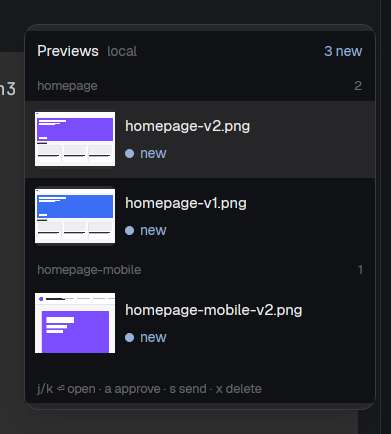

# Previews

A floating drawer for the images your coding agent draws — and a one-key way to
send the annotated feedback back to the agent.




## What it does

- **Watches `<project>/.herdr-previews/`** — the folder of the focused terminal.
  A PNG an agent saves there shows up within a few seconds, with a toast and a
  sound.
- **A rail, then a list.** Idle, the drawer is a 36 px strip on the right edge
  with an unread badge. Hovered, or focused with `alt-p`, it opens into a list of
  cards grouped by file stem (`homepage-v1.png`, `homepage-v2.png` → `homepage`),
  newest group first, the 40 newest images overall.
- **Status per image**: `new`, `reviewed` (once opened), `approved`.
- **Pop-out viewer**: the image at its real aspect ratio, zoom and pan, a
  numbered pin wherever you click, a pen and a circle tool for drawings, a note
  on every pin and every drawing, and `Compare` to put an older draft beside the
  current one.
- **Send notes** types the feedback into the space's agent through `hc send` —
  `Feedback on draft: <path>` plus one line per pin — and `Approve` adds
  `Approved: <path>`. Notes live next to the images in `notes.json`.
- **Works in a space on another machine**: images are copied over ssh, notes are
  written with `exec`.

## Keys

| Key | Does |
|---|---|
| `alt-p` | focus the drawer |
| `j` / `k` | move between cards |
| `x` `x` | delete the image (armed; press again) |
| `Esc` | back to the pane on the left |
| `[` / `]` | previous / next draft in the pop-out |

## Install

```sh
cp -r mods/previews ~/.config/herdr-app/mods/previews
# merge keys.json into ~/.config/herdr-app/keys.json
herdr-app check ~/.config/herdr-app/mods/previews
```

Then place it as a floating block on the right edge of a **personal** layout
(shipped layouts are rewritten on every app start, so a block added to them does
not survive):

```json
"floating": [{ "id": "previews", "content": { "mod": "previews" }, "edge": "right", "align": "center" }]
```

Without a layout change, `herdr-app do mod.open '{"name":"previews"}'` opens it.

**Teach your agent the convention**: paste `mods/previews/agent-snippet.md` into
the project's `AGENTS.md`, so captures land in `.herdr-previews/<target>-vN.png`
and the drawer picks them up by itself.

## Notes

- The project is the focused terminal's working directory, not the space folder.
- Shown images are copied into the mod's own `.cache/`; the originals are never
  modified.
- It runs `find`, `rm`, `sh`/`ssh`/`base64`/`mv` (remote copies and writes) and
  `hc send`. Nothing else touches the network.

`RECIPE.md` is the full build brief — every dimension, colour, state and
command.

Part of [herdr-mods](https://github.com/v1studios-mnellis/herdr-mods), the
working repo for all of my herdr-app mods.
