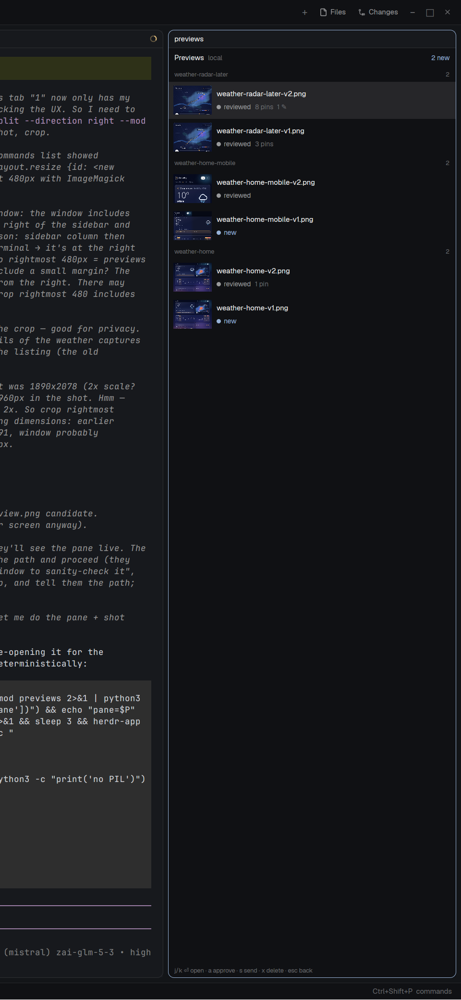

# Previews

When a coding agent draws something (a screenshot, a mockup, a rendered page) it
saves the image into `.herdr-previews/` in the space's folder. This mod shows
those images in a pane beside your terminal (`alt-p` opens it). Click one and a large,
draggable window opens: drop numbered pins on the image with the mouse (or draw on it with a pen, or a circle with shift), write a note on each pin and on each drawing, mark the draft approved, and send the annotated feedback straight
back to the space's agent with one key. A new image raises a toast and a sound.



## What you see

**The pane.** A mod pane, split off to the right of the terminal by `alt-p`
(`pane.split` with `direction: right`); no layout block is needed. It is as big as
the split makes it, on `chrome`, and the card list scrolls. Top to bottom:

- A 32 px header: "Previews" (12 px, semibold), the space's name in `dim`
  (truncated), and on the right "N new" in `accent` (or the image count in `dim`).
- Groups. A 24 px header per group: the group name (10 px, semibold, `dim`) and
  its image count. A group is images with the same file stem: the extension and
  any trailing `-vN`/`-N`, unix timestamp (10 or 13 digits) or ISO date are
  stripped, so `homepage-v3.png` and `homepage-v2.png` are group `homepage`.
  Groups run by their newest image, newest first; images inside a group too.
  Only the 40 newest images are listed.
- Cards, 62 px high, 8 px side padding, 8 px gap: a 64×48 thumbnail (rounded 4,
  on `raised`, image contained) and, beside it, the file name (12 px,
  `foreground`, truncated) and a line with a status dot and word plus
  "N pins" in `dim` when there are pins. The selected card is on `selected`; a
  hovered one on `hover`.
- A 22 px footer in `dim`, 10 px: the key summary ("j/k ⏎ open · a approve · s send · x delete · esc back"); it turns `blocked`-colored with "press x again to delete <file>" while
  a delete is armed, or with the error text if listing/copying/saving failed.

Empty: "No previews yet. Agents save PNGs to .herdr-previews/ in the project as
<name>-vN.png (see agent-snippet.md); alt-p opens this pane." A space without a
folder says so.

**Status.** Every image is `new` (`accent` dot), `reviewed` (`muted`) or
`approved` (`done`). Images without a stored entry are `new`.

**The pop-out window.** 72% of the window wide, 85% high, dragged by its title bar
or any part that is not a control, remembered by herdr (key `preview`). On
`surface`, top to bottom:

- A 40 px title bar on `chrome`: file name (13 px, semibold), "draft N of M" (the
  position in its group, newest = M) or "single draft", the status chip, the zoom (`83%`, `accent` when not 100%), then on
  the right: `Compare` / `Single` (only when an older draft exists), `Approve`
  (`accent`), `Send notes`, `Close`.
- Left, on `background`: the image at its real aspect ratio, as large as fits
  (small images are scaled up to fit; zoomable, see below), centered, with a small caption above it. Each pin is a
  20 px `accent` circle with its number (11 px, `accent_foreground`), centered on
  its spot; the pin being edited has a `foreground` ring. In compare mode the
  previous (next older) draft is on the left, labeled "previous · name", and the
  current one, with its pins, on the right, "current · name".
- Right, a 250 px panel on `chrome`: "Pins (N) · tool: pin [1-2]" and two small
  tool buttons ("1 pin", "2 draw"); one row per pin (number, note,
  `dim` "no note" when empty; the selected row on `selected`); under the rows,
  the drawings ("Drawings (N) · click to add a note", then "✎ pen 1 · note", "○ circle 2 · no note", the selected row on `selected`, each with a ✕; strokes of the old `line` kind in a notes file are still listed as "─ line N"); then, for the selected pin or drawing, "Note for pin N · Esc to finish" or "Note for drawing N (pen) · Esc to finish" and a 4-row text area
  (`background`, `input` border); finally a 10 px key hint line.

## How it behaves

**Which space.** The pane follows the space it sits in (the space whose tab holds
it; `props().pane` may name it, else the focused previews pane, whose id is then
remembered; else the active space). It watches `<project>/.herdr-previews/` on that space's machine (local or
remote), re-reading every 3 s. The project is the live folder of the terminal
beside the pane. `focused()` can't give it: while the pane has the keyboard it is
the focused pane. So `projectRoot` takes the focused terminal pane in the same tab
(`panes()` entries with a `terminal` and a `cwd`), remembers it (`lastTerm`) while
the keyboard is in the pane, and otherwise uses the remembered one, else the tab's
first terminal, else the space's focused terminal (`focused()`, when it is in that
space), else any terminal in the space, and last the space's `folder`. The pop-out
gets the resolved project folder in its props. `cd`-ing elsewhere or focusing another terminal in the
tab switches the list. The pop-out stays on the space it was opened from.
Feedback goes to the focused agent of that space, or the first agent there; with
none, a warning toast says so.

**New images.** An image path not seen before (in that space, since the mod
started; the first listing is only the baseline) raises an `info` toast
"New preview" with the file name and space, plays the `done` sound. More than three at once are folded into one toast.

**Mouse, pane.** Click a card: it is selected, marked `reviewed` if it was
`new`, and the pop-out opens on it.

**Mouse, pop-out.** Left click on the image drops a pin there (stored as
percentages of the image's width and height) and puts the cursor in its note.
Left click on a pin, or on its row, selects it and focuses its note. Right click
on a pin deletes it. Each drawing has its own note too, kept apart from pin notes:
left click on a drawing's row in the Drawings list selects it and focuses its note
(the ✕ still only deletes). One note editor serves whichever pin or drawing is
selected. Notes are saved when focus leaves the text area. Pressing on
the image, a pin, a button or the text area never drags the window.

**Keys, pane.** `alt-p` (`keys.json`: `pane.split` right with `mod: previews`) opens
the pane; `pane.go` or a click moves the keyboard onto it (the mod focuses itself on
the `focus` command). Then `up`/`k`, `down`/`j` move the selection (wraps,
scrolls into view); `enter` opens the pop-out; `a` approves the selected image;
`shift-a` approves every `new` image in its group; `s` sends its notes; `x` asks
for confirmation (press again within 3 s) and deletes the file; `escape`
(handled by the pane's own `on_key_down`) puts the keyboard back on the
terminal the list is about (`pane.focus`, if that pane still exists), else the pane
on the left.

**Drawing, pop-out.** The tool is shown in the panel header and picked with keys
`1`/`p` pin (the default: a left click drops a pin) and `2`/`d` draw, or the
panel's buttons. In draw mode, press on the image, drag and release: the pen
follows the pointer; with shift held at the press it is a circle instead, an
ellipse centred on the press with the pointer's distance as its radii. There is
no line tool (too close to the pen); old `line` strokes still render and are
still sent. A stroke is drawn in `accent` (as it was when drawn). A
click without a drag draws nothing. A release outside the image also ends the
stroke. `backspace` removes the last stroke (closing its note editor if it was
selected); the ✕ on a row removes that one.
Right click on a pin still deletes the pin (pressing a pin in draw mode starts
a stroke instead of selecting it).

**Zoom, pop-out.** The image is first fitted to the stage (a small source image,
say a 525×444 radar PNG, is upscaled to fill it), then multiplied by a zoom of
0.25–8× (default 1). `+`/`=` zoom in ×1.25, `-`/`_` out ÷1.25, `0` resets; the
mouse wheel over the stage zooms smoothly (`exp(-dy·0.001)`) and does not scroll.
The title bar shows the zoom as a percent. The stage is a scroll container
(both axes) around a content box that is at least stage-sized (so a fitted image
stays centered) and as large as the image when zoomed in: pan with shift + wheel
or the trackpad's own scroll. Pins and strokes are percentages of the frame, so they
follow the zoom; the stroke SVG is re-sized for the new frame on the next poll.

**Keys, pop-out.** It takes the keyboard when it opens. `[` or `,` shows the
previous (older) draft of the group, `]` or `.` the next (newer); `enter` toggles
compare; `a` approve, `s` send, `x` delete (two presses; then the neighbouring
draft, or the window closes); `escape` closes. While a note is being typed all
keys type; `escape` leaves the text area first.

**Approve / send.** `Approve` sets the status to `approved` and sends; `Send` only
sends. The message pasted into the agent's terminal (with Enter, via `hc send`):

```
Feedback on draft: /abs/path/homepage-v3.png
- pin 1 at (12%, 50%): move this up
- pin 2 at (80%, 9%): no note
Drawn marks (percent of the image):
- [pen] (10%, 10%) → (12%, 14%) → … : "make this curve smoother"
- [line] (20%, 30%) → (60%, 30%)   (only from old drafts)
- [circle] center (50%, 50%) r (10%, 20%) : "crop to this"

Approved: /abs/path/homepage-v3.png
```

(Pin notes and drawing notes are separate sections: the pin lines, then the
"Drawn marks" lines. A drawing line ends with ` : "note"` (JSON-quoted, so one
line) only when that drawing has a note. `Feedback…` and the pin/mark lines only when there are pins or strokes; a freehand
path is thinned to at most 12 points; `Approved:` only for
approve; several images are separated by a blank line.) Sending without pins
shows a warning toast "Nothing to send". Success is a `success` toast
("Approved homepage-v3.png", "Sent feedback on …"); failure an `error` toast.

**Persistence.** Notes live next to the images in `.herdr-previews/notes.json`:
`{ "<abs path>": { "status": "new|reviewed|approved", "pins": [{ "x", "y", "text" }], "strokes": [...] } }`.
A stroke is `{ "tool": "pen|circle|line", "color": "#hex", "text": "optional note", ... }` with percent coordinates:
pen `pts: [{x,y}]`, circle centre `c` and radii `rx`/`ry`, line `a`/`b` (read-only: the
UI no longer creates lines, old ones are kept, drawn and sent).
Every edit is applied in memory at once, then re-applied to a fresh read of the
file and written, so the pane and the window don't overwrite each other.

**Stroke overlay.** All of an image's strokes (and the one being drawn) are one SVG,
`viewBox="0 0 100 100" preserveAspectRatio="none"`, `fill="none"`, 3 px
`vector-effect="non-scaling-stroke"` round-cap lines, shown by
`image(rel).size_full()` in an `absolute().inset_0()` div over the image and the pins
(it has no mouse handlers, so presses reach the pins and the frame). While drawing,
the file is rewritten at most every 30 ms (`SVG_THROTTLE_MS`) and the write's
`cx.notify()` is the repaint, and once more on release. Each write
is a new file `mods/previews/.cache/strokes-<hash>-<n>.svg` (n counts up; the old
versions are removed) because the renderer may cache by path. Strokes loaded from
`notes.json` get their file on the next poll (`ensureStrokes`). The pane's cards
show a "N ✎" count.

## Install

Copy the mod folder into the app and bind `alt-p`; no layout edit is needed (the
mod is `"place": "none"` and opens as a pane):

```bash
cp -r mods/previews ~/.config/herdr-app/mods/previews   # never overwrite an existing name; rename instead
# add the alt-p entry from keys.json to ~/.config/herdr-app/keys.json (ask before replacing a key you already use)
herdr-app check ~/.config/herdr-app/mods/previews
```

`keys.json` binds global `alt-p` to `pane.split` with `direction: right` and
`mod: previews`. Add it to your own `keys.json` by hand if you keep a customized one.

Also paste the content of `agent-snippet.md` into the project's `AGENTS.md`, and
into any agent skill that produces screenshots (e.g. impeccable), so agents know
to save PNGs as `.herdr-previews/<target>-vN.png`. The mod never writes an
`AGENTS.md` itself; the snippet is added by hand.

## Built from

- `agent-snippet.md`: the ready-to-paste AGENTS.md fragment describing the
  `.herdr-previews/<target>-v<N>.png` convention.
- `mod.json`: `{ "place": "none", "title": "Previews", "focusable": true }`:
  not docked anywhere; `pane.go` can focus the pane.
- `keys.json`: global `alt-p` → `{ "command": "pane.split", "args": { "direction":
  "right", "mod": "previews" } }`.
- `main.js`: `export default class Previews extends View`. `init` branches on
  `props().overlay`: the pane copy (card list, key handling, new-image
  announcements) or the pop-out copy (opened with
  `openOverlay({ mod: "previews", kind: "window", key: "preview", width: 0.72,
  height: 880, props: { path, machine, folder, space } })`).
  - Both: `this.h = cx.focus_handle()`, `.track_focus(this.h).on_key_down(...)` on
    the root; `cx.timer.every(1000, ...)` polls on every third tick (and at once
    when the binding changes); `theme()` colors only.
  - Pane: `spaces()` (the space holding the pane: `machine`, `folder`), `panes()`
    (own pane via `props().pane`; the tab's terminal panes' `cwd` and `focused`),
    `focused()` (fallback `cwd`), `agents()` (focused in that space, else first),
    `ScrollHandle.scroll_to_item`, `nextCommand()` loop for `"focus"`
    (`this.h.focus()`), `notify`, `playSound("done")`,
    `run("pane.focus", { pane })`, `openOverlay`.
  - Pop-out: `this.zoom`, `on_scroll_wheel` (zoom), `overflow_scroll()` on the stage,
    `closeOverlay(props().overlay)`, `TextareaState.new({ rows: 4 })`
    with `.on("change" | "focus" | "blur")`, `on_size_change` on the image area,
    `on_mouse_down("left" | "right")` with `e.local_position` / `e.bounds` and
    `cx.stop_propagation()` on every control, pins as `.absolute().left(px).top(px)`
    children of a `.relative()` frame sized to the drawn image.
- `lib.js`: `stemOf`/`groupItems` (grouping), `listImages` (`exec("find", [dir,
  "-maxdepth", "1", "-type", "f", "(", "-name", "*.png", "-o", ... ")", "-printf",
  "%T@\t%p\n"], { on: machine })`), `cachedImage`/`removeCached`/`imageSize` (see
  below), `readNotesRaw` (`readTextFile(path, { on: machine })`), `parseNotes`,
  `writeNotesText`, `strokesSvg`/`writeStrokeSvg` (overlay file), `feedbackText`, `sendToAgent` (`hc(["send", address, text])`;
  `address` is the core address, `t4` or `anton/t3`).
- Images: `image(path)` reads only below `~/.config/herdr-app`, so every shown
  image is copied to `mods/previews/.cache/<hash>-<mtime ms>.<ext>` (hidden folder,
  so saving there never reloads the mod; `.gitignore`d). Local: `fs.readFile` + `fs.writeFile`.
  Remote: `exec("sh", ["-c", 'ssh "$1" base64 -- "$2" > "$3.b64" && base64 -d
  "$3.b64" > "$3.tmp" && mv "$3.tmp" "$3"; …', "sh", machine, remotePath, dest])`
  (the machine's name is an ssh alias). A changed mtime is a new name; the older
  copy of that file is removed. Header sizes of PNG/JPEG/WebP (`sizeFromBytes`)
  give the aspect ratio, so pin percentages match the image, not its letterbox.
- Notes writes: local `writeTextFile(path, text, expectedRaw)` (optimistic lock;
  a stale snapshot is retried, three times); remote `exec("sh", ["-c", 'printf %s
  "$2" | base64 -d > "$1.tmp" && mv "$1.tmp" "$1"', "sh", path, base64], { on:
  machine })`. `writeTextFile` and `watchFolder` are local-only, hence polling
  and `exec` for remote spaces.
- Programs run: `find`, `rm` (on delete), `sh`/`ssh`/`base64`/`mv` (remote copies
  and writes), `hc send`. Nothing uses the network except through `ssh`.

## Watch out

- Pop-out windows are content-sized unless given pixel width/height; fractions
  alone can shrink the frame to content and let the panel overflow it. The mod
  passes a fixed pixel height (880) with `width: 0.72`, an `overflow_hidden()`
  `size_full()` root, and internal scroll areas: the panel is `min_h(0).max_h_full()`,
  the marks list is `flex_1().min_h(0)` and scrolls, the note editor sits in an
  `h(64)` scrolling `flex_none` wrapper, and the other panel rows are `flex_none`.
- Pop-out windows are content-sized at first layout, so `on_size_change` can report
  ~0 height initially; the stage has min size 560x420 and `windowView` falls back to
  1000x640 until measured.
- Stroke SVGs must live in the hidden `.cache` dir and get a new versioned name
  per save: writing a file under `mods/` outside a dot-dir reloads the mod, so a
  non-hidden path would reload it on every save, mid-stroke; and a reused path may
  be served from the renderer's cache.
- Stroke width is computed from the rendered frame pixels, not left to the
  renderer: `frame()` records `this.framePx`, and `strokesSvg` uses a viewBox of
  that pixel size (percent coordinates scaled into it) with `stroke-width` 2, so a
  line is 2 px on screen on both axes. `vector-effect="non-scaling-stroke"` is not
  relied on. The SVG is rewritten when the frame size drifts more than 10%.
- Pointer coordinates are the window `position` minus the frame's `bounds`
  origin, over `bounds.width/height`. `local_position` was off from the cursor in
  live use, so don't go back to it (pin drops and strokes both use `pointAt`).
- Realtime drawing: the host does NOT hot-update an `image()`/`svg()` asset when a
  file under the hidden `.cache` dir changes on disk (verified live: an edited
  stroke SVG did not repaint without a mod-side `cx.notify()`). So each update is a
  fresh versioned file plus a notify. Every notify repaints the whole window, so
  the lever is a tight throttle: `extendStroke` updates `this.live` and, at most
  every 30 ms (`SVG_THROTTLE_MS`, timestamp check), calls `saveStrokes`, which
  writes the file and notifies. `svgBusy`/`svgDirty` serialize writes and make
  the last state land; the mouse-up always writes. Nothing else runs mid-drag:
  `poll` (no notes.json re-read) and `ensure` return early while `this.live` is
  set. The save keeps its version in memory (no readdir per write, only the
  previous file is unlinked).
- Not verified without a real mouse and window: drawing itself (the pointer
  mapping and the 2 px width were checked only by reading the code).
- `svg()` theme-tints the file with the text color, so every stroke came out one
  pale color. Use `image()` for the colored stroke overlay: it renders the SVG in
  full color (live-verified).
- `image()` paths are relative to `~/.config/herdr-app`. An absolute project path
  silently draws nothing, which is why every image is cached first.
- A local file younger than 1.5 s is not copied yet (it may still be written); the
  next 3 s poll picks it up.
- Discovery runs GNU `find -printf`, so the mod assumes Linux (GNU findutils) on the
  local machine and on any remote one; on macOS/BSD the poll finds nothing.
- The mod sandbox's `fs/promises` exposes only `mkdir`/`readdir`/`unlink`/`readFile`/
  `writeFile` (no `stat`/`copyFile`/`rename`/`cp`); copies are `readFile` + `writeFile`,
  and "exists" is a `readdir` check.
- Module top level has no side effects (herdr reloads the module on every save).
  No `setTimeout`; no `cx` is kept across callbacks. Text areas are made in `init`,
  never in `render`.
- A press the mod doesn't stop drags a window, so every clickable thing in the
  pop-out stops its `left` mouse down; the title bar and empty panel areas don't.
- Keystroke names are matched as herdr reports them: `shift-a`, `escape`, `[`,
  `,`. Plain letters only act while no note is being typed.
- Key actions to the mod are `<mod>.<command>` (the `focus` command); the
  `mod:command` form in the `nextCommand` doc comment would run a command named
  `previews`. There is no `mod:previews` key section: the pop-out copy has no
  command loop, so `escape` is handled in each copy's own `on_key_down`.
  `alt-p` splits every time it is pressed, so a second press opens a second pane.
- The pane is itself the focused pane while you use it, so the project folder is
  never read from `focused()` alone (see "Which space").
- At most 40 images are listed and copied; a space's folder that is empty ("home")
  has no previews. Notes are matched to images by absolute path, so renaming or
  moving a folder starts the statuses over. Deleting a file leaves no trash.
- Concurrent edits to one notes file are merged by re-applying the edit; pin edits
  are by index, so two people deleting pins on one image at once can misfire.
- Not interactively tested here: `herdr-app check` loads and renders once; the
  async paths (polling, copying, `hc send`) need a running window.

## Done when

- `herdr-app check mods/previews` exits 0.
- With a PNG saved into `<space folder>/.herdr-previews/`, within 3 s a toast
  "New preview" appears with the `done` sound, and the open pane shows a card with
  its thumbnail, name and a `new` dot (the header says "1 new").
- Clicking the card opens the pop-out with the full image and the card turns
  `reviewed`; clicking the image adds a numbered pin where you clicked and
  focuses a note; typing a note and pressing `escape` stores it in `notes.json`
  as percentages; right-clicking the pin removes it.
- `Send notes` pastes `Feedback on draft: <path>` and a `- pin N at (x%, y%): text`
  line per pin into the space's focused agent and shows a success toast;
  `Approve` also adds `Approved: <path>` and turns the status to `approved`.
- Saving `name-v2.png` next to `name-v1.png` puts both in group `name`; `[`/`]` in
  the pop-out move between them and `Compare` shows the older on the left.
- `alt-p` opens the pane to the right of the terminal and it lists the previews of
  that terminal's folder, also while the pane itself has the keyboard; `j`/`k`
  move, `x` `x` deletes the file, `escape` returns to the terminal.
- In a space on another machine the same works (copies over ssh, notes written
  with `exec`).
